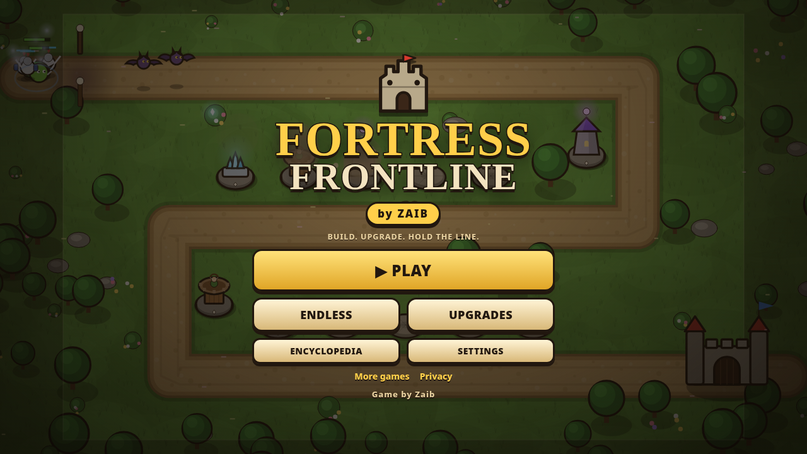
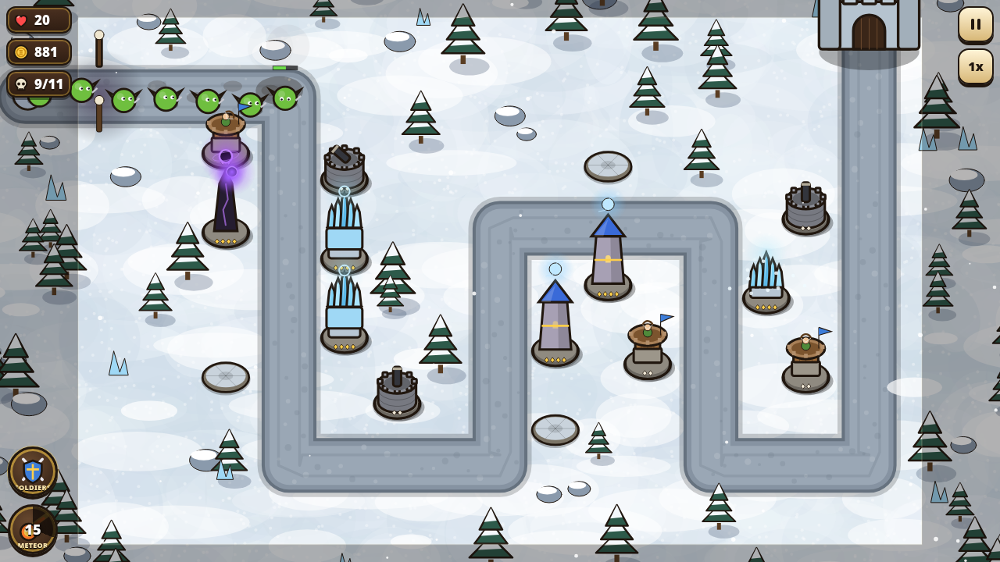

# Fortress Frontline by Zaib

A Kingdom Rush-style fantasy tower defense game for mobile and desktop. Everything lives in one self-contained `index.html`: canvas graphics, synthesized WebAudio, and no external libraries.

**Play:** https://zaibgames.com/fortress-frontline/

## Features
- 30 handcrafted levels across 4 worlds: Greenvale, Sandspire Dunes, Frostpeak Pass and Ashen Wastes. Each world ends with a boss.
- 4 towers (Archer, Artillery, Mage, Frost). Each has 3 tiers plus a choice of 2 specialised branches.
- 17 enemy types: fast, armoured, flying, healers, splitters, burrowers, summoners and regenerators. 4 bosses have special abilities.
- Hero abilities: Meteor Strike and Reinforcements, both with cooldowns.
- Call waves early for bonus coins and shorter ability cooldowns.
- 3-star rating per level and a permanent star upgrade tree (28 nodes).
- Endless mode with a map for each world, an encyclopedia, 1x/2x speed and a tutorial.
- Works in portrait and landscape, with touch, mouse and keyboard.

## Controls
- **Touch/mouse:** tap a stone spot to open the build menu. Tap an option once to see its info and again to confirm. Tap a tower to upgrade or sell it.
- **Keyboard:** 1-4 choose a tower, U/Enter upgrades, S sells, Space/N calls the next wave, Q casts Meteor, W/E sends Reinforcements, F toggles speed, Esc/P pauses.

Game by Zaib · [More games](https://zaibgames.com/) · [Privacy](https://zaibgames.com/privacy/)

